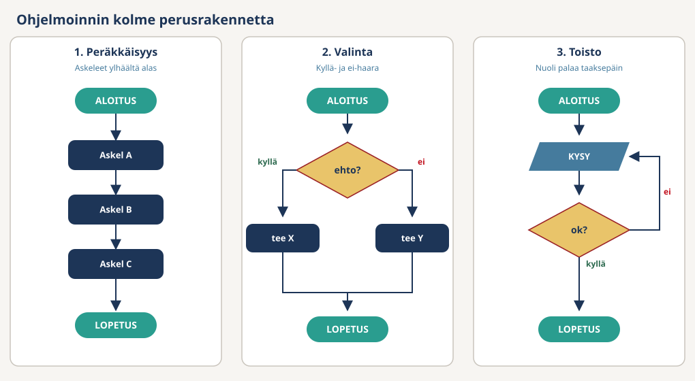

# Algoritmi (Algorithm)

**Algoritmi** on askellista, jota tietokone voi seurata sellaisenaan. Tietokone tekee täsmälleen sen, mitä lista sanoo. Se ei arvaa puuttuvaa askelta eikä korjaa epäselvää.

Arjen esimerkki on teen keittäminen. Ihmiselle riittää tämä:

```
1. Keitä vesi
2. Laita teepussi kuppiin
3. Kaada vesi kuppiin
4. Odota
5. Ota teepussi pois
```

Tietokoneelle lista on liian epätarkka. Kuinka kauan "odota" kestää? Mistä tiedetään, että vesi kiehuu? Mitä tehdään, jos keitin on tyhjä? Tarkennettu versio kelpaa:

```
1. Täytä vedenkeitin vedellä
2. Käynnistä vedenkeitin
3. Odota, kunnes vesi kiehuu
4. Laita teepussi kuppiin
5. Kaada kiehuva vesi kuppiin
6. Odota 3 minuuttia
7. Nosta teepussi pois kupista
```

Askeleessa 3 piilee jo ohjelmoinnin ydin: kysymys *"kiehuuko jo?"* ja toisto *"jos ei, odota lisää ja tarkista uudelleen"*.

**Muita lähteitä:** [Wikipedia: Algoritmi](https://fi.wikipedia.org/wiki/Algoritmi)

## Kartta

Sama askellista voidaan esittää neljässä muodossa. Sisältö ei muutu, vain esitystapa.

| Muoto | Mitä se on | Sivu |
|-------|------------|------|
| Askellista | Numeroidut askeleet suomeksi | tämä sivu |
| Vuokaavio | Sama kuvana: laatikot ja nuolet | [Vuokaavio](Flowchart.md) |
| Pseudokoodi | Sama tekstinä, melkein koodia | [Pseudokoodi](Pseudocode.md) |
| C#-koodi | Sama kielellä, jonka kääntäjä ymmärtää | [Ohjausrakenteet](../00-Basics/Control-Structures.md) |

Kurssin ensimmäisellä viikolla kirjoitetaan askellistoja, vuokaavioita ja pseudokoodia. Toisella viikolla samat rakenteet puetaan C#-kielelle.

## Hyvä algoritmi

Tällä kurssilla hyvä algoritmi täyttää kolme ehtoa.

| Ominaisuus | Selitys |
|------------|---------|
| **Yksiselitteinen** | Jokaisen askeleen voi suorittaa vain yhdellä tavalla |
| **Äärellinen** | Algoritmi päättyy joskus eikä jatku ikuisesti |
| **Järjestetty** | Askelten järjestyksellä on väliä |

Jokaisen ehdon voi rikkoa:

| Ehto | Rikkova esimerkki | Korjaus |
|------|-------------------|---------|
| Yksiselitteinen | "Odota." Kuinka kauan? | "Odota 3 minuuttia." |
| Äärellinen | "Kysy salasanaa, kunnes se on oikein." Jos käyttäjä ei koskaan arvaa, kysely ei pääty. | Laske yritykset ja lopeta kolmannen väärän jälkeen. |
| Järjestetty | "Kaada vesi kuppiin" ennen askelta "laita teepussi kuppiin" toimii vielä. "Nosta teepussi pois" ennen "laita teepussi kuppiin" ei toimi. | Tarkista, että jokainen askel voi onnistua edellisten jälkeen. |

Tietokone huomauttaa vain osasta virheitä. Epäselvä askel ei käänny C#-koodiksi lainkaan. Ikuinen toisto sen sijaan kääntyy ja ajaa, kunnes suljet ohjelman.

## Kolme rakennetta

Kolme rakennetta riittää kuvaamaan minkä tahansa ohjelman.



| Rakenne | Mitä tapahtuu | Vuokaaviossa |
|---------|----------------|--------------|
| **Peräkkäisyys** | Askeleet suoritetaan järjestyksessä alusta loppuun | Suora putki, nuolet eteenpäin |
| **Valinta** | Ohjelma haarautuu ehdon mukaan | Salmiakki ja kyllä/ei-nuolet |
| **Toisto** | Sama askel toistuu, kunnes ehto täyttyy | Nuoli takaisin aiempaan kohtaan |

Alla jokainen rakenne on kirjoitettu kolmessa muodossa: askellistana, pseudokoodina ja C#-koodina. Huomaa, että pseudokoodi ja C# ovat lähes sama teksti.

### Peräkkäisyys

Askellista: *kysy nimi, tervehdi nimellä.*

```
KYSY name
TULOSTA "Hei, " + name
```

```csharp
string? name = Console.ReadLine();
Console.WriteLine($"Hei, {name}");
```

### Valinta

Askellista: *kysy ikä. Jos ikä on alle 12, lippu on lastenlippu, muuten aikuisten lippu.*

```
KYSY age

JOS age < 12
    TULOSTA "Lastenlippu"
MUUTEN
    TULOSTA "Aikuisten lippu"
```

```csharp
if (age < 12)
{
    Console.WriteLine("Lastenlippu");
}
else
{
    Console.WriteLine("Aikuisten lippu");
}
```

### Toisto

Askellista: *kysy PIN-koodia niin kauan, kunnes se on 1234.*

```
KYSY pin

NIIN KAUAN KUIN pin != 1234
    TULOSTA "Väärä PIN"
    KYSY pin

TULOSTA "Tervetuloa"
```

```csharp
int pin = Convert.ToInt32(Console.ReadLine());

while (pin != 1234)
{
    Console.WriteLine("Väärä PIN");
    pin = Convert.ToInt32(Console.ReadLine());
}

Console.WriteLine("Tervetuloa");
```

Sisennetyt rivit toistuvat. Rungon viimeinen askel kysyy uuden PIN-koodin, joten ehto voi muuttua epätodeksi. Ilman sitä riviä toisto olisi ikuinen.

## Askella algoritmi käsin

Algoritmin voi testata ilman tietokonetta. Valitse syöte, seuraa askeleita sormella ja kirjaa, mitä tapahtuu. Tätä kutsutaan **simuloinniksi**.

Arvosana-algoritmi:

```
KYSY points

JOS points < 50
    TULOSTA "Hylätty"
MUUTEN JOS points < 75
    TULOSTA "Hyvä"
MUUTEN
    TULOSTA "Kiitettävä"
```

| Syöte | `points < 50` | `points < 75` | Tuloste |
|-------|---------------|---------------|---------|
| 30 | tosi | ei tarkisteta | Hylätty |
| 50 | epätosi | tosi | Hyvä |
| 74 | epätosi | tosi | Hyvä |
| 75 | epätosi | epätosi | Kiitettävä |

Valitse syötteiksi **raja-arvot**: luku juuri rajan alla ja luku tasan rajalla. Yhden merkin ero ehdossa (`<` vai `<=`) näkyy vain näillä arvoilla.

Sama taito tarvitaan myöhemmin kahdessa paikassa. Tentin *"mitä ohjelma tulostaa"* -kysymykset ovat simulointia paperilla. Debuggerin F10 on simulointia koneella: [Debuggaus](../00-Basics/Debug.md).

## Yleisiä virheitä

**1. Epämääräinen askel**

"Tarkista salasana" ei kerro, mihin verrataan eikä mitä tehdään väärällä salasanalla. Kirjoita vertailu auki: *jos salasana on "kissa", jatka, muuten kysy uudelleen*.

**2. Toisto ilman loppua**

Toiston rungossa pitää tapahtua jotain, mikä voi tehdä ehdosta epätoden. Jos PIN-kysely toistaa vain viestiä "Väärä PIN" eikä kysy uutta koodia, ehto `pin != 1234` on tosi ikuisesti. C#:ssa sama virhe: [ikuinen silmukka](../00-Basics/Control-Structures.md#ikuinen-silmukka).

**3. Ehdot väärässä järjestyksessä**

Jos arvosana-algoritmissa kysytään ensin `points < 75` ja vasta sitten `points < 50`, syöte 30 saa arvosanan "Hyvä". Leveä ehto nappaa myös kapean tapauksen. Laita **kapein** ehto ensin. C#:ssa sama sääntö: [ehtojen järjestyksellä on väliä](../00-Basics/Control-Structures.md#ehtojen-järjestyksellä-on-väliä).

**4. Oletus, jota ei kirjoitettu**

"Kaada vesi kuppiin" olettaa, että kuppi on olemassa ja tyhjä. Ihminen täyttää aukot itse. Tietokone ei. Jos askel voi epäonnistua, kirjoita, mitä silloin tehdään.

## Tehokkuus — myöhemmin

Myöhemmin algoritmeja vertaillaan myös sen mukaan, kuinka paljon aikaa ja muistia ne käyttävät. Tätä mitataan Big O -notaatiolla. Sitä ei tarvita vielä. Ensin algoritmin pitää olla yksiselitteinen, äärellinen ja järjestetty.

Lisää: [Big O](Big-O.md).

## Yhteenveto

- Algoritmi on askellista, jonka tietokone voi suorittaa sellaisenaan.
- Hyvä algoritmi on yksiselitteinen, äärellinen ja järjestetty.
- Kolme rakennetta riittää: peräkkäisyys, valinta ja toisto.
- Sama algoritmi voidaan kirjoittaa askellistana, vuokaaviona, pseudokoodina ja C#-koodina.
- Testaa algoritmi askeltamalla se käsin raja-arvoilla.

Seuraavaksi: [Vuokaavio](Flowchart.md) · [Pseudokoodi](Pseudocode.md) · [Ohjausrakenteet](../00-Basics/Control-Structures.md)
