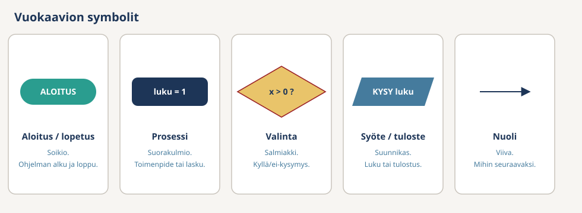
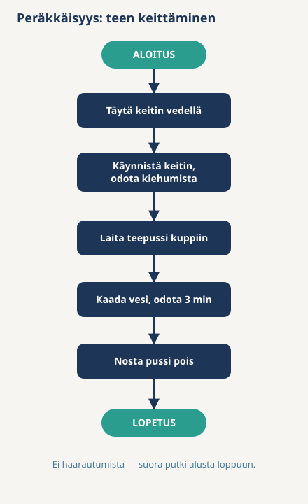
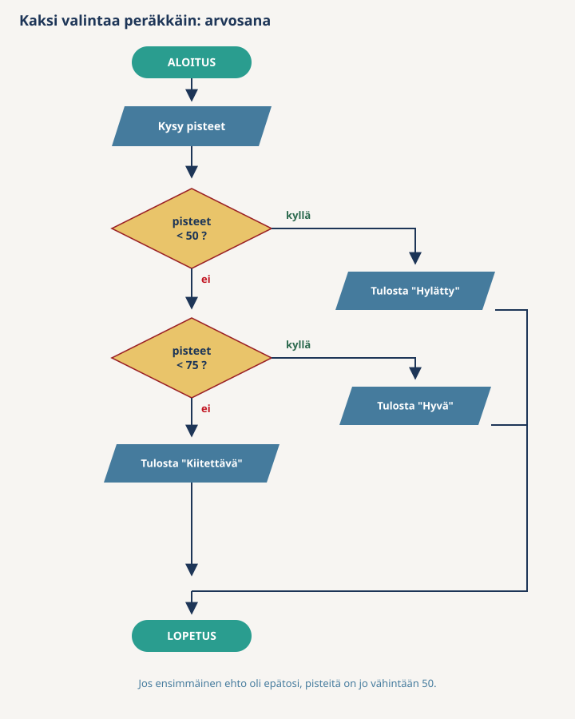
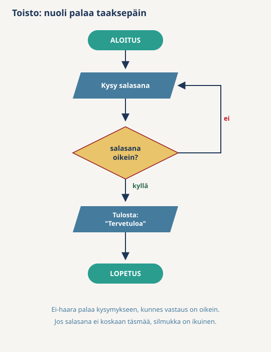

# Vuokaavio (Flowchart)

**Vuokaavio** on algoritmin kuva. Askeleet ovat laatikoita, ja nuolet kertovat, mihin laatikkoon mennään seuraavaksi. Kaaviosta näkee yhdellä silmäyksellä, missä ohjelma haarautuu ja missä se palaa taaksepäin.

Arjen esimerkki on kartta. Askellista on reittiohje tekstinä: "käänny vasemmalle, sitten oikealle". Vuokaavio on sama reitti piirrettynä. Risteyksen näkee kartasta heti, tekstistä vasta lukemalla.

Vuokaavio piirretään **ennen** koodia. Kun haarat ja silmukat ovat paperilla, koodin kirjoittaminen on kääntämistä: jokainen laatikko on rivi tai lohko C#-koodia.

**Muita lähteitä:** [Vuokaavio (omaantahtiin.com)](https://matikka.omaantahtiin.com/pitkamatikka/maa11/vuokaavio)

## Kartta

| Kaaviossa | Pseudokoodissa | C#-koodissa |
|-----------|----------------|-------------|
| Soikio ALOITUS / LOPETUS | ensimmäinen ja viimeinen rivi | `Main`-metodin alku ja loppu |
| Suunnikas "Kysy ikä" | `KYSY age` | `Console.ReadLine()` |
| Suunnikas "Tulosta hinta" | `TULOSTA price` | `Console.WriteLine(price)` |
| Suorakulmio "saldo = saldo - summa" | `balance = balance - amount` | `balance = balance - amount;` |
| Salmiakki "ikä < 12?" | `JOS age < 12` | `if (age < 12)` |
| Nuoli, joka palaa taaksepäin | `NIIN KAUAN KUIN` | `while` |

Pseudokoodin avainsanat: [Pseudokoodi](Pseudocode.md). C#-rakenteet: [Ohjausrakenteet](../00-Basics/Control-Structures.md).

## Vuokaavion symbolit

Viisi symbolia riittää tällä kurssilla.

| Symboli | Muoto | Käyttö |
|---------|-------|--------|
| **Aloitus / Lopetus** | Soikio | Ohjelman alku- ja loppupiste |
| **Prosessi** | Suorakulmio | Toimenpide, esimerkiksi laskutoimitus tai arvon asetus |
| **Valinta** | Salmiakki | Kyllä/ei-kysymys, jonka kohdalla kaavio haarautuu kahtia |
| **Syöte / Tuloste** | Suunnikas | Tiedon lukeminen käyttäjältä tai tulostaminen ruudulle |
| **Nuoli** | Viiva | Suoritusjärjestys: mihin mennään seuraavaksi |

Salmiakista lähtee aina **kaksi** nuolta. Nimeä ne: toinen on **kyllä**, toinen **ei**. Ilman nimiä lukija ei tiedä, kumpaan haaraan mennään.

Kirjoita salmiakin kysymys **vertailuna**, joka on tosi tai epätosi: `pituus >= 140?`, ei "onko tarpeeksi pitkä?". Vertailu kääntyy suoraan koodiksi.

## Kolme rakennetta vuokaaviossa

Jokainen vuokaavio rakentuu kolmesta peruskuviosta. Ne vastaavat [algoritmin kolmea rakennetta](Algorithm.md#kolme-rakennetta).

### Peräkkäisyys — suora putki

Soikio, sitten suorakulmioita ja suunnikkaita, lopuksi soikio. Nuolet kulkevat vain eteenpäin. Jokainen ajo tekee samat asiat samassa järjestyksessä.

### Valinta — salmiakki haarauttaa

Salmiakki keskellä putkea. Kyllä-nuoli vie yhteen haaraan, ei-nuoli toiseen. Haarat yhtyvät taas, jos ohjelma jatkuu yhteistä polkua.

Seuraa kaaviota arvoilla 139, 140 ja 141. Ehto on `pituus >= 140`, joten 140 menee kyllä-haaraan. Jos ehto olisi `pituus > 140`, 140-senttinen jäisi rannalle. Yhden merkin ero vaihtaa tuloksen rajalla.

### Monta haaraa peräkkäin

Kolme luokkaa vaatii kaksi salmiakkia peräkkäin. Toinen kysytään vain, jos ensimmäinen vastasi "ei". Siksi toisessa salmiakissa riittää `pisteet < 75`: jos tähän asti päästiin, pisteitä on jo vähintään 50. **Ehtojen järjestys kantaa tietoa.**

Jos salmiakit vaihdetaan toisin päin (ensin `< 75`, sitten `< 50`), syöte 30 päätyy haaraan "Hyvä". Laita kapein ehto ensin.

### Toisto — nuoli palaa taaksepäin

Salmiakki kysyy "salasana oikein?". Ei-nuoli palaa takaisin kysymykseen, kyllä-nuoli jatkaa eteenpäin. Ilman paluunuolta kaavio ei toista mitään.

Paluunuolen sisään jäävä silmukka pyörii niin kauan, kuin salmiakki vastaa "ei". Jos salasana ei koskaan täsmää, silmukka on ikuinen. Rajoitus syntyy laskurilla ja toisella salmiakilla: "yrityksiä < 3?".

## Lue kaavio sormella

Kaavio testataan samalla tavalla kuin askellista: valitse syöte ja seuraa nuolia sormella ALOITUS-soikiosta LOPETUS-soikioon. Kirjaa jokaisen salmiakin vastaus ja jokainen tuloste.

Tarkista kolme asiaa:

1. Päättyykö jokainen polku LOPETUS-symboliin?
2. Onko jokaisella salmiakilla sekä kyllä- että ei-nuoli?
3. Muuttuuko toiston sisällä jokin, mikä voi kääntää salmiakin vastauksen?

Valitse syötteiksi raja-arvot: luku juuri rajan alla, tasan rajalla ja juuri yli. Katso [askella algoritmi käsin](Algorithm.md#askella-algoritmi-käsin).

## Yleisiä virheitä

**1. Nuolia ei ole nimetty.** Salmiakista lähtee kaksi nuolta, mutta kumpikaan ei kerro, onko se kyllä vai ei. Kaaviota ei voi lukea.

**2. Salmiakista lähtee yksi nuoli.** Kysymys, jolla on vain yksi vastaus, ei ole valinta. Joko toinen haara puuttuu tai salmiakin pitäisi olla suorakulmio.

**3. Toisto ilman paluunuolta.** Kaaviossa lukee "kysy uudelleen", mutta nuoli jatkaa eteenpäin. Kone ei palaa taaksepäin, ellei nuoli palaa.

**4. Toisto, jonka ehto ei voi muuttua.** Silmukka tulostaa "Väärä salasana" ja palaa salmiakkiin, mutta uutta salasanaa ei kysytä. Vastaus on ikuisesti "ei". Lisää KYSY-askel silmukan sisään.

**5. Polku, joka ei pääty.** Jokin haara jää ilman nuolta tai LOPETUS-soikiota. Seuraa jokainen polku loppuun asti.

## Piirtotyökalu

Kynä ja paperi riittävät harjoitteluun. Siistiin kaavioon sopii [draw.io](https://app.diagrams.net/): vasemman reunan paletista kohta **Flowchart** sisältää kaikki viisi symbolia. Lyhyt ohje: [draw.io](DrawIO.md).

## Yhteenveto

- Vuokaavio on algoritmi kuvana: laatikot ovat askeleita, nuolet suoritusjärjestys.
- Viisi symbolia: soikio, suorakulmio, salmiakki, suunnikas ja nuoli.
- Salmiakista lähtee aina kaksi nimettyä nuolta, kyllä ja ei. Kysymys kirjoitetaan vertailuna.
- Peräkkäisyys on suora putki, valinta on salmiakki, toisto on nuoli taaksepäin.
- Testaa kaavio sormella raja-arvoilla. Jokaisen polun pitää päättyä LOPETUS-symboliin.

Seuraavaksi: [Pseudokoodi](Pseudocode.md) · [Algoritmi](Algorithm.md) · [draw.io](DrawIO.md)
