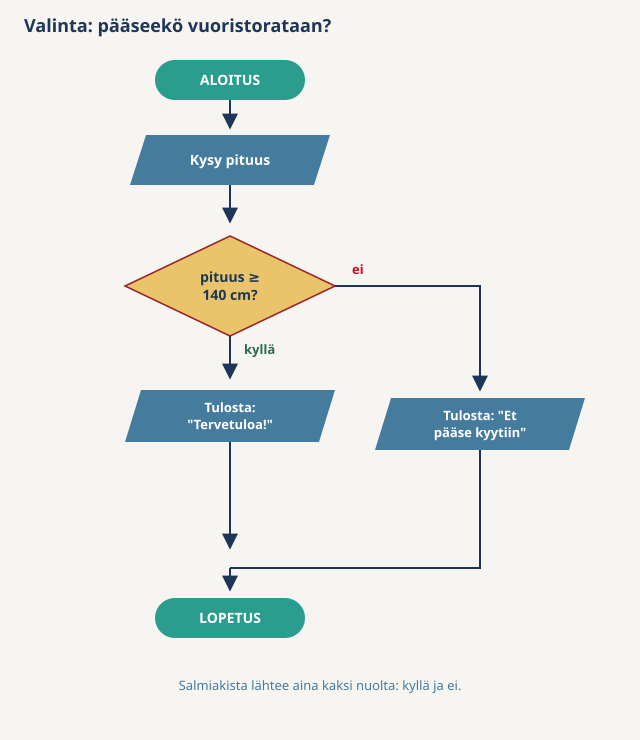

# Pseudokoodi (Pseudocode)

## Mikä on pseudokoodaus?

**Pseudokoodi** on algoritmi kirjoitettuna rakenteelliseksi tekstiksi, joka muistuttaa ohjelmointikieltä mutta ei noudata minkään kielen kielioppia. Se ei ole suoritettavaa koodia. Sen tarkoitus on kuvata ohjelman logiikka niin tarkasti, että koodin kirjoittaminen on enää kääntämistä.

Arjen esimerkki on resepti, jonka askeleet on numeroitu ja sisennetty: "toista, kunnes taikina on sileää" ja sen alla sisennettynä "vaivaa minuutti, tarkista". Kuka tahansa kokki osaa seurata sitä, vaikka ei tunne kirjoittajan keittiötä.

Saman ratkaisun voi piirtää [vuokaaviona](Flowchart.md). Pseudokoodin `JOS` on vuokaavion salmiakki, ja `NIIN KAUAN KUIN` on nuoli, joka palaa taaksepäin. Vuokaavio on parempi kokonaiskuvaan, pseudokoodi on nopeampi kirjoittaa ja muuttaa.

## Avainsanat

Kurssilla käytetään näitä avainsanoja. Kirjoitusasu on vapaa, mutta ole johdonmukainen.

| Avainsana | Merkitys | Vastaava rakenne C#:ssa |
|-----------|----------|-------------------------|
| `KYSY x` | Lue syöte käyttäjältä muuttujaan `x` | `Console.ReadLine()` |
| `TULOSTA "..."` | Tulosta teksti tai arvo | `Console.WriteLine(...)` |
| `x = arvo` | Sijoita arvo muuttujaan | `x = arvo;` |
| `JOS ehto` … `MUUTEN JOS ehto` … `MUUTEN` | Valinta | `if` / `else if` / `else` |
| `NIIN KAUAN KUIN ehto` | Toisto | `while` |

`LUE` tarkoittaa samaa kuin `KYSY`. Jotkin lähteet kehystävät ohjelman sanoilla `ALOITA` ja `LOPPU`. Kehys on valinnainen, ja kurssin tehtävissä sitä ei käytetä.

## Kolme sääntöä

1. **Yksi askel per rivi.** "Kysy ikä ja laske hinta" on kaksi riviä.
2. **Sisennys näyttää rakenteen.** `JOS`-rivin alla sisennetyt rivit kuuluvat ehdon sisään. `NIIN KAUAN KUIN` -rivin alla sisennetyt rivit toistuvat. Kun sisennys loppuu, rakenne loppuu.
3. **Ehto on vertailu, joka on tosi tai epätosi.** `age < 12`, `pin != 1234`, `answer == "k"`. Sanallinen ehto ("jos ikä on sopiva") ei käänny koodiksi.

## Esimerkit

### Esimerkki 1: Tervehdys

```
KYSY name
TULOSTA "Hei, " + name + "!"
```

Pelkkää peräkkäisyyttä: kaksi askelta, ei haaroja.

### Esimerkki 2: Yksinkertainen laskin

```
KYSY number1
KYSY number2
KYSY operation

JOS operation == "+"
    result = number1 + number2
MUUTEN JOS operation == "-"
    result = number1 - number2
MUUTEN JOS operation == "*"
    result = number1 * number2
MUUTEN JOS operation == "/"
    result = number1 / number2
MUUTEN
    TULOSTA "Tuntematon operaatio"

TULOSTA result
```

Viimeinen `MUUTEN` on turvaverkko. Ilman sitä syöte `x` jättäisi tuloksen laskematta, eikä algoritmi kertoisi miksi.

### Esimerkki 3: Pariton vai parillinen

```
KYSY number

JOS number % 2 == 0
    TULOSTA "Luku on parillinen"
MUUTEN
    TULOSTA "Luku on pariton"
```

`%` on jakojäännös. Parillisen luvun jakojäännös kahdella on nolla. Pseudokoodissa saa kirjoittaa myös "jos luku on jaollinen kahdella".

### Esimerkki 4: Alennusprosentti

```
KYSY age

JOS age < 10
    discountPercent = 10
MUUTEN JOS age <= 60
    discountPercent = 0
MUUTEN
    discountPercent = 5

TULOSTA "Alennusprosenttisi on " + discountPercent + "%"
```

Toisessa ehdossa riittää `age <= 60`. Jos ensimmäinen ehto oli epätosi, ikä on jo vähintään 10. Ehtojen järjestys kantaa tietoa.

### Esimerkki 5: Alennusprosentti laajennettu

```
KYSY age
KYSY isStudent

JOS isStudent
    discountPercent = 15
MUUTEN JOS age < 10
    discountPercent = 10
MUUTEN JOS age <= 60
    discountPercent = 0
MUUTEN
    discountPercent = 5

TULOSTA "Alennusprosenttisi on " + discountPercent + "%"
```

Opiskelija-ehto on ensimmäisenä, jotta opiskelija saa aina 15 %. Jos se olisi viimeisenä, 8-vuotias opiskelija saisi 10 %, koska ensimmäinen tosi ehto voittaa.

### Esimerkki 6: Toisto — salasana

```
KYSY password

NIIN KAUAN KUIN password != "kissa"
    TULOSTA "Väärä salasana, yritä uudelleen"
    KYSY password

TULOSTA "Tervetuloa"
```

Sisennetyt rivit toistuvat niin kauan kuin ehto on tosi. Kun salasana on oikein, suoritus jatkuu sisennyksen jälkeiseltä riviltä. Vuokaaviossa sama kohta on salmiakki, jonka ei-nuoli palaa kysymykseen.

Rungon viimeinen rivi `KYSY password` on välttämätön. Ilman sitä `password` ei koskaan muutu, ehto on aina tosi ja toisto on ikuinen.

### Esimerkki 7: Kertymä — ostosten summa

```
total = 0
count = 0
KYSY price

NIIN KAUAN KUIN price != 0
    total = total + price
    count = count + 1
    KYSY price

TULOSTA "Ostoksia: " + count
TULOSTA "Yhteensä: " + total
```

`total` on **kertymä**: se kerää summaa joka kierroksella. `count` on **laskuri**: se kasvaa yhdellä joka kierroksella. Kumpikin alustetaan **ennen** silmukkaa. Jos `total = 0` olisi silmukan sisällä, summa nollautuisi joka kierroksella ja jäljelle jäisi vain viimeinen hinta.

Syöte `0` lopettaa silmukan. Sellaista arvoa, joka ei ole kelvollinen hinta, kutsutaan lopetusarvoksi.

Samalla laskurilla rajoitetaan yrityksiä: salasanakysely lopetetaan, kun laskuri saavuttaa kolme. Silloin silmukan ehto tarvitsee kaksi osaa: `password != "kissa"` **ja** `attempts < 3`.

## Sama ratkaisu kolmessa muodossa

Vuoristorataan pääsee, jos pituus on vähintään 140 cm.



Pseudokoodina:

```
KYSY height

JOS height >= 140
    TULOSTA "Tervetuloa!"
MUUTEN
    TULOSTA "Et pääse kyytiin"
```

C#-koodina:

```csharp
Console.Write("Anna pituus (cm): ");
int height = Convert.ToInt32(Console.ReadLine());

if (height >= 140)
{
    Console.WriteLine("Tervetuloa!");
}
else
{
    Console.WriteLine("Et pääse kyytiin");
}
```

Rakenne on sama kaikissa kolmessa. C# lisää vain kieliopin: tyypin `int`, sulkeet, aaltosulkeet ja puolipisteet. Siksi hyvä pseudokoodi kääntyy koodiksi rivi riviltä.

## Yleisiä virheitä

**1. Liian epämääräinen askel**

```
tarkista salasana
```

Mihin verrataan? Mitä tehdään, jos salasana on väärä? Kirjoita vertailu ja molemmat haarat auki, kuten esimerkissä 6.

**2. Liian koodimainen**

```
Console.WriteLine("Hei");
int age = int.Parse(Console.ReadLine());
```

Tämä on jo C#-koodia. Pseudokoodin tarkoitus on ajatella rakenne ilman kielioppia. Jos osaat jo kirjoittaa koodin suoraan, kirjoita koodi.

**3. Sisennys puuttuu**

```
NIIN KAUAN KUIN password != "kissa"
TULOSTA "Väärä salasana"
KYSY password
TULOSTA "Tervetuloa"
```

Mitkä rivit toistuvat? Ilman sisennystä ei tiedä, kuuluuko "Tervetuloa" silmukan sisään vai sen jälkeen.

**4. Toiston runko ei muuta ehtoa**

```
KYSY pin

NIIN KAUAN KUIN pin != 1234
    TULOSTA "Väärä PIN"
```

`pin` ei koskaan muutu. Toisto on ikuinen. Lisää `KYSY pin` silmukan sisään.

## Harjoitustehtäviä

Kirjoita jokaisesta pseudokoodi. Tehtävät 1–3 tehdään myös kurssin ensimmäisessä harjoituksessa **Vuokaaviot ja pseudokoodi** *(kurssitehtävä Moodlessa)*.

1. **Tervehdys.** Pyydä käyttäjältä nimi ja tulosta "Hei, [nimi]!".
2. **Yksinkertainen laskin.** Pyydä kaksi lukua ja laskutoimitus (summa, erotus, tulo tai osamäärä). Tulosta tulos.
3. **Pariton vai parillinen.** Pyydä kokonaisluku ja kerro, onko se pariton vai parillinen.
4. **Alennusprosentti.** Kysy ikä. Alle 10-vuotias saa 10 %, 10–60-vuotias 0 % ja yli 60-vuotias 5 %. Tulosta prosentti.
5. **Laajenna alennusprosenttia.** Kysy myös, onko käyttäjä opiskelija. Opiskelija saa 15 %.
6. **Salasana enintään kolmella yrityksellä.** Kysy salasanaa, kunnes se on oikein. Laske yritykset. Kolmannen väärän yrityksen jälkeen tulosta "Liian monta yritystä" ja lopeta. Tarvitset toiston, laskurin ja kaksi ehtoa.

## Yhteenveto

- Pseudokoodi on algoritmi tekstinä: melkein koodia, mutta ilman kielioppia.
- Avainsanat: `KYSY`, `TULOSTA`, `x = arvo`, `JOS` / `MUUTEN JOS` / `MUUTEN`, `NIIN KAUAN KUIN`.
- Yksi askel per rivi, sisennys näyttää rakenteen, ehto on vertailu.
- Kertymä ja laskuri alustetaan ennen silmukkaa. Toiston rungossa pitää olla askel, joka voi muuttaa ehdon.
- Hyvä pseudokoodi kääntyy C#-koodiksi rivi riviltä.

Seuraavaksi: [Vuokaavio](Flowchart.md) · [Algoritmi](Algorithm.md) · [Konsolin syöte ja tulostus](../00-Basics/Console-IO.md)
