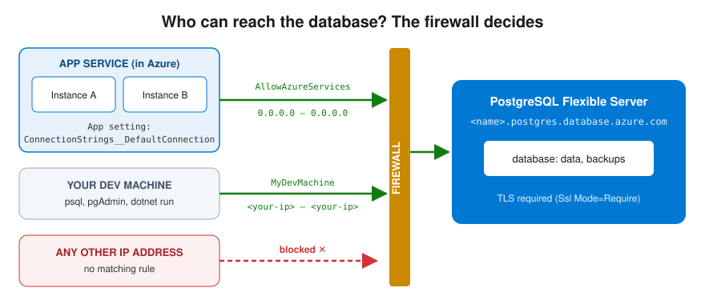

# Azure Database for PostgreSQL — a managed database in the cloud

> 🇫🇮 Finnish version: [Azure-Database-PostgreSQL.md](../../Azure/Azure-Database-PostgreSQL.md)

## Table of Contents

1. [Why a managed database?](#why-a-managed-database)
2. [The Flexible Server service model](#the-flexible-server-service-model)
3. [Pricing tiers and costs](#pricing-tiers-and-costs)
4. [Creating the server](#creating-the-server)
5. [Networking and firewall](#networking-and-firewall)
6. [Connection string](#connection-string)
7. [Using it from a .NET application (EF Core + Npgsql)](#using-it-from-a-net-application-ef-core--npgsql)
8. [Microsoft Entra authentication — connecting without a password](#microsoft-entra-authentication--connecting-without-a-password)
9. [Stop, start and cost management](#stop-start-and-cost-management)
10. [Best practices](#best-practices)

---

## Why a managed database?

A cloud application's **state** (data) must not live in the application process's memory or on an application instance's disk — otherwise horizontal scaling and restarts will break the data. State is moved to an **external, managed database**.

A **managed database (PaaS)** means that Azure takes care of:

| Azure handles | You handle |
|---------------|------------|
| Server hardware and the operating system | Schema and data |
| PostgreSQL installation and updates | Queries and indexes |
| Backups (7 days by default) | Managing the connection string and secrets |
| High availability (optional) | Choosing the SKU and costs |
| Storage expansion | Firewall rules |

The alternative would be to install PostgreSQL yourself on a virtual machine (IaaS) — then all the work in the left column would be yours. In student and production projects, a managed service is almost always the right choice.

```
Application (App Service, stateless)       Database (Flexible Server)
┌──────────────┐  ┌──────────────┐         ┌────────────────────────┐
│  Instance A  │  │  Instance B  │  ─────► │  PostgreSQL            │
│  (no state)  │  │  (no state)  │         │  → data, backups       │
└──────────────┘  └──────────────┘         │  → shared truth        │
                                           └────────────────────────┘
```

---

## The Flexible Server service model

**Azure Database for PostgreSQL – Flexible Server** is Azure's current PostgreSQL service model (the old "Single Server" has been retired). The name "flexible" refers to the fact that you can choose compute and storage separately and stop the server.

Key features:

- Full PostgreSQL — normal tools work (psql, pgAdmin, EF Core, Npgsql)
- **Burstable tier** for studying and development (cheap, bursting CPU)
- **Stop/Start** — compute is not billed for a stopped server
- Automatic backups, point-in-time restore
- Firewall rules or VNet integration

---

## Pricing tiers and costs

The price consists of **two parts**: compute (per hour) and storage (per GB/month).

### Development and studying

| SKU | vCores | RAM | Compute ~/month | Notes |
|-----|--------|-----|-----------------|-------|
| **B1ms** (Burstable) | 1 | 2 GB | ~€13 | Plenty for a course project |
| **B2s** (Burstable) | 2 | 4 GB | ~€26 | If B1ms is not enough |

### Production

| SKU | vCores | RAM | Compute ~/month | Notes |
|-----|--------|-----|-----------------|-------|
| **D2ds_v5** (General Purpose) | 2 | 8 GB | ~€130 | Steady performance, no bursting |

In addition, storage: the smallest size **32 GB ≈ €4/month**. 

> **Important cost note:** Storage is billed **even for a stopped server**. Only deleting the server stops billing completely.

> **In student projects:** use **Burstable B1ms + 32 GB**. Stop the server when you are not using it — or delete it and recreate it when needed with a script/Bicep.

---

## Creating the server

### Azure CLI

The CLI examples on this page are written for **PowerShell** (backtick `` ` `` line continuation, `$VAR = "..."`). In bash, use `\` and `VAR=...`.

```powershell
# Variables
$RG = "rg-myapp-dev"
$PG = "pg-myapp-<unique-id>"     # the name must be globally unique
$LOCATION = "northeurope"

# Create a Flexible Server (Burstable B1ms, PostgreSQL 16)
az postgres flexible-server create `
  --resource-group $RG `
  --name $PG `
  --location $LOCATION `
  --tier Burstable `
  --sku-name Standard_B1ms `
  --storage-size 32 `
  --version 16 `
  --admin-user myadmin `
  --admin-password "<strong-password>" `
  --database-name myappdb `
  --public-access <your-ip>
```

| Parameter | Explanation |
|-----------|-------------|
| `--tier Burstable` + `--sku-name Standard_B1ms` | Cheapest tier — the CPU "bursts" when needed |
| `--storage-size 32` | Smallest possible disk (GB) |
| `--version 16` | PostgreSQL version |
| `--admin-user` / `--admin-password` | Administrator credentials — **must not end up in version control** |
| `--database-name` | Also creates the application's database |
| `--public-access <your-ip>` | Opens the firewall to your own machine (for development) |

Creation typically takes 5–10 minutes.

> **Password tip:** generate a strong password and do not write it into the script. In PowerShell you can read it at run time: `$pw = Read-Host -AsSecureString "DB password"`.

> **The same server in Bicep:** see [Example 6: PostgreSQL Flexible Server](Infrastructure-as-Code.md#example-6-postgresql-flexible-server). The CLI command and the Bicep resource create exactly the same thing — Bicep just makes it repeatable.

### Testing the connection

Before touching the application, check that the server answers. Install `psql` (comes with [PostgreSQL](https://www.postgresql.org/download/) or `winget install PostgreSQL.psql`) and connect from your own machine:

```powershell
psql "host=$PG.postgres.database.azure.com port=5432 dbname=myappdb user=myadmin sslmode=require"
```

```
myappdb=> \conninfo
You are connected to database "myappdb" as user "myadmin" on host "pg-myapp-xyz.postgres.database.azure.com" ... SSL connection (protocol: TLSv1.3 ...)
myappdb=> \q
```

| Symptom | Likely cause |
|---|---|
| `no pg_hba.conf entry for host "1.2.3.4"` | Your IP is not in the firewall rules — add it (next section) |
| `password authentication failed` | Wrong user or password; the user is `myadmin`, not `myadmin@servername` |
| `could not translate host name` | Typo in the server name, or the server has not finished creating |
| `connection timed out` | The server is stopped, or your network blocks port 5432 |

---

## Networking and firewall

By default, the Flexible Server's public endpoint is **completely closed**. Connections are allowed with firewall rules:



```powershell
# Allow Azure services (e.g. App Service) — special rule 0.0.0.0
az postgres flexible-server firewall-rule create `
  --resource-group $RG `
  --name $PG `
  --rule-name AllowAzureServices `
  --start-ip-address 0.0.0.0 `
  --end-ip-address 0.0.0.0

# Allow your own development machine
az postgres flexible-server firewall-rule create `
  --resource-group $RG `
  --name $PG `
  --rule-name MyDevMachine `
  --start-ip-address <your-ip> `
  --end-ip-address <your-ip>
```

| Rule | Meaning |
|------|---------|
| `0.0.0.0 – 0.0.0.0` | Special value: "allow traffic from within Azure" (App Service, Functions...). Does **not** mean the whole internet |
| `<your-ip> – <your-ip>` | A single IP — your own machine for development |

> **Note:** `AllowAzureServices` allows traffic from *all* Azure services, including those of other customers. It is an acceptable shortcut in development and student projects; in production, VNet integration or a private endpoint is used.

---

## Connection string

A PostgreSQL connection string in Npgsql format:

```
Host=pg-myapp-xyz.postgres.database.azure.com;Database=myappdb;Username=myadmin;Password=<password>;Ssl Mode=Require
```

| Part | Explanation |
|------|-------------|
| `Host` | The server's fully qualified DNS name (`<name>.postgres.database.azure.com`) |
| `Database` | Database name |
| `Username` / `Password` | The administrator or a user created for the application |
| `Ssl Mode=Require` | Azure requires a TLS-encrypted connection |

### Where should the connection string go?

| Environment | Location | Why |
|-------------|----------|-----|
| Local development | `appsettings.Development.json` (local database) or User Secrets (Azure database) | No production secrets in the repo |
| Azure App Service | **Application Settings**: `ConnectionStrings__DefaultConnection` | The environment variable overrides appsettings.json |
| Production (best level) | Key Vault + Managed Identity | No passwords in any configuration |

```powershell
# Set it in App Service
az webapp config appsettings set `
  --resource-group $RG `
  --name $APP `
  --settings ConnectionStrings__DefaultConnection="Host=...;Database=...;Username=...;Password=...;Ssl Mode=Require"
```

> **Two underscores (`__`)** correspond to the JSON hierarchy: `ConnectionStrings__DefaultConnection` = `{ "ConnectionStrings": { "DefaultConnection": "..." } }`. The code does not change between environments — only the configuration does.

---

## Using it from a .NET application (EF Core + Npgsql)

```bash
dotnet add package Npgsql.EntityFrameworkCore.PostgreSQL
```

```csharp
// Program.cs
builder.Services.AddDbContext<AppDbContext>(options =>
    options.UseNpgsql(builder.Configuration.GetConnectionString("DefaultConnection")));
```

```csharp
// Data/AppDbContext.cs
public class AppDbContext : DbContext
{
    public AppDbContext(DbContextOptions<AppDbContext> options) : base(options) { }

    public DbSet<Product> Products => Set<Product>();
}
```

### Creating the schema: EnsureCreated vs. migrations

| | `Database.EnsureCreated()` | EF Core migrations |
|---|---|---|
| **What it does** | Creates the schema directly from the model if the database does not exist | Versioned change scripts (`dotnet ef migrations add`) |
| **Schema changes** | Cannot update an existing database | Updates in a controlled way (`database update`) |
| **Suitable for** | Exercises, prototypes | Production and all longer-term development |

```csharp
// For exercises: create the schema at startup
using (var scope = app.Services.CreateScope())
{
    var db = scope.ServiceProvider.GetRequiredService<AppDbContext>();
    db.Database.EnsureCreated();
}
```

> **Gotcha:** `EnsureCreated()` runs only when the **process starts**. If the database is deleted and recreated while the app keeps running, the tables are not recreated until you restart the app (`az webapp restart`). `/health` may already say the server is reachable while queries still fail with "relation does not exist".

---

## Microsoft Entra authentication — connecting without a password

In addition to (or instead of) a password, Flexible Server supports **Microsoft Entra authentication**: you sign in to the database with an Entra identity and a short-lived token. For an application, combined with a [Managed Identity](../../Azure/Managed-Identity.md) *(in Finnish)*, this means that **the connection string contains no password at all**.

### Setting it up in outline

1. **Enable Entra authentication on the server** (Bicep `authConfig` or `az postgres flexible-server update --active-directory-auth Enabled`)
2. **An Entra admin for the server**: `az postgres flexible-server microsoft-entra-admin create ...` (`ad-admin create` in older CLI versions)
3. **A database role from the application's identity**: connected as the Entra admin, run in the `postgres` database:

```sql
select * from pgaadauth_create_principal('<app-service-name>', false, false);
```

4. **Grant permissions to the role** in the application's database (`GRANT` as usual)
5. **The application fetches a token** with the scope `https://ossrdbms-aad.database.windows.net/.default` and uses it as the password — in Npgsql, `NpgsqlDataSourceBuilder.UsePeriodicPasswordProvider` renews the token automatically

### Signing in with a token in psql (as a developer)

```powershell
$env:PGPASSWORD = az account get-access-token --resource-type oss-rdbms --query accessToken --output tsv
psql "host=<server>.postgres.database.azure.com dbname=postgres user=<your-upn> sslmode=require"
```

### Why is this better than a password?

| Password | Entra token |
|----------|-------------|
| Long-lived — a leak is a permanent problem | Valid ~1 h — a leak expires on its own |
| Must be stored somewhere (secret, vault) | Not stored — fetched when needed |
| Rotation is a manual project | "Rotation" happens automatically every hour |
| Easily shared by all users | Identity-specific — the audit log shows who did what |

Password authentication can eventually be disabled entirely (`passwordAuth: 'Disabled'`), so that no password exists for the server at all.

---

## Stop, start and cost management

A Flexible Server can be **stopped**, in which case compute is not billed (storage is still billed):

```powershell
# Stop (compute billing stops)
az postgres flexible-server stop --resource-group $RG --name $PG

# Start
az postgres flexible-server start --resource-group $RG --name $PG

# Delete completely (all billing stops — the data is lost!)
az postgres flexible-server delete --resource-group $RG --name $PG --yes
```

> **Note:** A stopped server **starts automatically after 7 days**. Stopping is therefore a pause, not a permanent solution. If you will not need the database for weeks, delete it and recreate it with a script or Bicep.

### Cost checklist

1. Check the SKU's price before creating it (Pricing Calculator)
2. Burstable B1ms is enough for studying
3. Stop the server when you are not using it — remember the automatic start after 7 days
4. Storage is always billed — delete an unneeded server completely
5. Tags (`Environment`, `Owner`) on the database just like on other resources

---

## Best practices

### ✅ Good practices

- **Connection string in an environment variable** (App Service Application Settings) — never in code or in the repo
- **`Ssl Mode=Require`** always for Azure connections
- **The smallest sufficient SKU** and stop/delete when not in use
- **Migrations** as soon as the schema starts to evolve (EnsureCreated only for exercises)
- **Keep the firewall minimal**: your own IP for development, AllowAzureServices for the application — never `0.0.0.0–255.255.255.255`

### ❌ Avoid these

- Do not commit a password — not even "temporarily"
- Do not use the administrator account as the application's account in production (create a separate user)
- Do not leave a B1ms server running unused for months — that is ~€17/month of idling
- Do not run `EnsureCreated()` against a production database that already has data and migrations

---

## Next

- [Azure App Service](../../Azure/App-Service.md) *(in Finnish)* - Hosting the application and Application Settings
- [Azure Key Vault](../../Azure/Key-Vault.md) *(in Finnish)* - Managing secrets at production level
- [Infrastructure as Code](Infrastructure-as-Code.md) - Creating the database with Bicep

## Back

- [Azure services — Overview](README.md)
