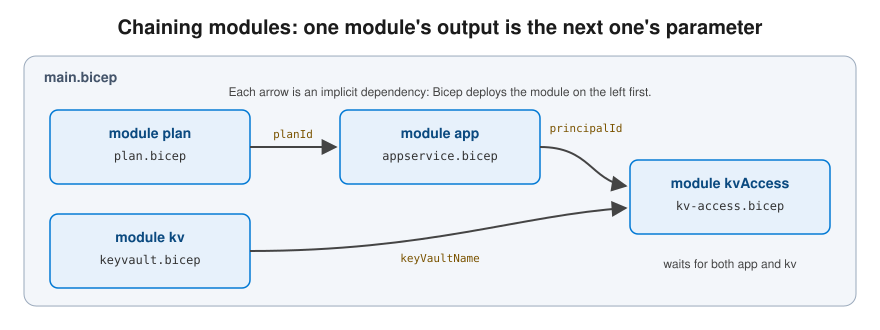

# Bicep - Azure's IaC language

> 🇫🇮 Finnish version: [Bicep.md](../../Azure/Bicep.md)

## Table of Contents

1. [What is Bicep?](#what-is-bicep)
2. [Setting up the development environment](#setting-up-the-development-environment)
3. [Bicep syntax](#bicep-syntax)
4. [Types and decorators](#types-and-decorators)
5. [Dependencies between resources](#dependencies-between-resources)
6. [Referencing existing resources](#referencing-existing-resources)
7. [Scope and deployment levels](#scope-and-deployment-levels)
8. [Modules in depth](#modules-in-depth)
9. [Bicep functions](#bicep-functions)
10. [User-Defined Types](#user-defined-types)
11. [Testing and validation](#testing-and-validation)
12. [Common patterns](#common-patterns)
13. [Troubleshooting](#troubleshooting)
14. [Cheat sheet](#cheat-sheet)

---

## What is Bicep?

**Bicep** is Azure's domain-specific language (DSL), developed to replace ARM JSON templates with a syntax that is easier to read and write. Behind the scenes, Bicep compiles into ARM JSON.

> For IaC fundamentals and basic Bicep examples, see: [Infrastructure as Code](Infrastructure-as-Code.md)

This page focuses on Bicep's **more advanced features** and practical patterns.

---

## Setting up the development environment

### Required tools

```bash
# 1. Install the Azure CLI
# Windows (winget):
winget install Microsoft.AzureCLI

# macOS:
brew install azure-cli

# 2. Install Bicep (it comes with the Azure CLI, but make sure you have the latest version)
az bicep install
az bicep upgrade

# 3. Check the versions
az --version
az bicep version
```

> **PowerShell users:** the multi-line CLI examples on this page use bash line continuation (`\`). In PowerShell, end the line with a backtick (`` ` ``) instead. The commands and their arguments are otherwise identical.

### VS Code extension

Install the **Bicep extension** in VS Code:

- Name: **Bicep** (Microsoft)
- Extension ID: `ms-azuretools.vscode-bicep`

The extension provides:

| Feature | Description |
|---|---|
| **IntelliSense** | Autocompletion for resources and properties |
| **Validation** | Real-time error checking |
| **Hover info** | Information about resource types on hover |
| **Go to definition** | Navigation to modules and parameters |
| **Refactoring** | Turning a value into a parameter, variable or module |
| **Visualization** | Graphical view of resources and dependencies |

---

## Bicep syntax

### Resource definition in detail

```bicep
// Basic resource
resource storageAccount 'Microsoft.Storage/storageAccounts@2023-01-01' = {
  name: 'stmyapp'               // Resource name in Azure (globally unique)
  location: resourceGroup().location
  sku: { name: 'Standard_LRS' }
  kind: 'StorageV2'
  properties: {                  // Resource-specific settings
    minimumTlsVersion: 'TLS1_2'
    allowBlobPublicAccess: false
  }
  tags: {                        // Metadata
    Environment: 'dev'
  }
}
```

Parts of a resource definition:

```
resource <symbolicName> '<type>@<apiVersion>' = {
  │         │              │         │
  │         │              │         └─ Azure API version (date)
  │         │              └─ Full type name of the resource
  │         └─ Name used to refer to the resource in Bicep code
  └─ Keyword
}
```

### Child resources

Child resources can be defined in two ways:

```bicep
// Option 1: Nested
resource storageAccount 'Microsoft.Storage/storageAccounts@2023-01-01' = {
  name: 'stmyapp'
  location: resourceGroup().location
  sku: { name: 'Standard_LRS' }
  kind: 'StorageV2'

  // The Blob service is a child of the Storage Account
  resource blobService 'blobServices' = {
    name: 'default'

    // The container is a child of the Blob service
    resource container 'containers' = {
      name: 'documents'
      properties: {
        publicAccess: 'None'
      }
    }
  }
}

// Option 2: Parent property (clearer in large files)
resource storageAccount2 'Microsoft.Storage/storageAccounts@2023-01-01' = {
  name: 'stmyapp2'
  location: resourceGroup().location
  sku: { name: 'Standard_LRS' }
  kind: 'StorageV2'
}

resource blobService 'Microsoft.Storage/storageAccounts/blobServices@2023-01-01' = {
  parent: storageAccount2
  name: 'default'
}

resource container 'Microsoft.Storage/storageAccounts/blobServices/containers@2023-01-01' = {
  parent: blobService
  name: 'documents'
  properties: {
    publicAccess: 'None'
  }
}
```

---

## Types and decorators

### Parameter types

```bicep
// Basic types
param myString string
param myInt int
param myBool bool
param myArray array
param myObject object

// Typed array
param vmNames string[]

// Typed object
param networkConfig {
  vnetName: string
  subnetName: string
  addressPrefix: string
}
```

### Decorators

Decorators add rules and metadata to parameters and variables:

```bicep
// Description (shown in the deployment and in documentation)
@description('Application name, used for naming resources')
param appName string

// Allowed values
@allowed(['dev', 'staging', 'prod'])
param environment string

// Length constraints
@minLength(3)
@maxLength(24)
param storageAccountName string

// Value constraints
@minValue(1)
@maxValue(10)
param instanceCount int = 1

// Secure parameter (not shown in logs or in the deployment history)
@secure()
param adminPassword string

// Metadata
@metadata({
  example: 'myapp'
  impact: 'Used in the names of all resources'
})
param projectName string
```

---

## Dependencies between resources

### Implicit dependencies (recommended)

Bicep detects dependencies automatically when you reference a property of another resource:

```bicep
// The App Service Plan is created first
resource appServicePlan 'Microsoft.Web/serverfarms@2023-12-01' = {
  name: 'asp-myapp'
  location: resourceGroup().location
  sku: { name: 'S1' }
}

// The Web App is created only after the Plan is ready (implicit dependency)
resource webApp 'Microsoft.Web/sites@2023-12-01' = {
  name: 'app-myapp'
  location: resourceGroup().location
  properties: {
    serverFarmId: appServicePlan.id    // ← This reference creates the dependency
  }
}
```

### Explicit dependencies

Sometimes there is no property to reference, so Bicep cannot see the dependency. The typical case: a module adds something to a resource that **another module creates**, but it receives the resource's name as a plain parameter instead of as the other module's output.

```bicep
// main.bicep
param serverName string

module postgres 'modules/postgres.bicep' = {
  name: 'postgresDeployment'
  params: {
    serverName: serverName
  }
}

module firewall 'modules/postgres-firewall.bicep' = {
  name: 'firewallDeployment'
  params: {
    serverName: serverName    // Same string as above — but NOT postgres.outputs.*, so no reference, no implicit dependency
  }
  dependsOn: [
    postgres                  // ← Without this, the firewall module may run before the server exists
  ]
}
```

```bicep
// modules/postgres-firewall.bicep
param serverName string

// The server is not created here, only referenced
resource postgresServer 'Microsoft.DBforPostgreSQL/flexibleServers@2024-08-01' existing = {
  name: serverName
}

resource allowAzure 'Microsoft.DBforPostgreSQL/flexibleServers/firewallRules@2024-08-01' = {
  parent: postgresServer
  name: 'AllowAzureServices'
  properties: {
    startIpAddress: '0.0.0.0'
    endIpAddress: '0.0.0.0'
  }
}
```

> **Rule of thumb:** prefer implicit dependencies — pass `postgres.outputs.serverName` instead of the raw parameter and the `dependsOn` becomes unnecessary. Use `dependsOn` only when there is genuinely nothing to reference. A `dependsOn` that duplicates an existing reference is harmless but the linter flags it as noise.

```
Dependency chain:

  App Service Plan ──→ Web App ──→ Role Assignment
                                        │
                       Key Vault ────────┘

  Bicep/ARM works out the correct creation order from the references.
```

---

## Referencing existing resources

### The `existing` keyword

Use it when you want to reference a resource that already exists in Azure (and you are not creating it again):

```bicep
// Reference an existing Key Vault in the same resource group
resource existingKeyVault 'Microsoft.KeyVault/vaults@2023-07-01' existing = {
  name: 'kv-myapp-prod'
}

// Use it in another resource
resource webApp 'Microsoft.Web/sites@2023-12-01' = {
  name: 'app-myapp'
  location: resourceGroup().location
  properties: {
    serverFarmId: appServicePlan.id
    siteConfig: {
      appSettings: [
        {
          name: 'KeyVaultUri'
          value: existingKeyVault.properties.vaultUri   // Read a value from the existing resource
        }
      ]
    }
  }
}

// Reference a resource in another resource group
resource existingVnet 'Microsoft.Network/virtualNetworks@2023-11-01' existing = {
  name: 'vnet-shared'
  scope: resourceGroup('rg-networking')   // A different resource group
}
```

---

## Scope and deployment levels

Azure supports four deployment levels:

```
┌─────────────────────────────────────────┐
│  Management Group                       │  targetScope = 'managementGroup'
│  ┌───────────────────────────────────┐  │
│  │  Subscription                     │  │  targetScope = 'subscription'
│  │  ┌─────────────────────────────┐  │  │
│  │  │  Resource Group             │  │  │  targetScope = 'resourceGroup' (default)
│  │  │  ┌───────────────────────┐  │  │  │
│  │  │  │  Resources            │  │  │  │
│  │  │  └───────────────────────┘  │  │  │
│  │  └─────────────────────────────┘  │  │
│  └───────────────────────────────────┘  │
└─────────────────────────────────────────┘
```

```bicep
// Subscription-level deployment (e.g. creating Resource Groups)
targetScope = 'subscription'

resource rg 'Microsoft.Resources/resourceGroups@2023-07-01' = {
  name: 'rg-myapp-dev'
  location: 'northeurope'
}

// The module is targeted at the newly created Resource Group
module resources 'modules/resources.bicep' = {
  name: 'resourcesDeployment'
  scope: rg    // ← Important: defines the target
  params: {
    location: rg.location
  }
}
```

### Deployment commands by level

```bash
# Resource Group level (default)
az deployment group create \
  --resource-group rg-myapp-dev \
  --template-file main.bicep

# Subscription level
az deployment sub create \
  --location northeurope \
  --template-file main.bicep

# Management Group level
az deployment mg create \
  --management-group-id myMgGroup \
  --location northeurope \
  --template-file main.bicep
```

---

## Modules in depth

### Anatomy of a module

A module is an ordinary `.bicep` file that is called from another file:

```bicep
// modules/appservice.bicep

// INPUTS: What the module needs
param location string
param appName string
param environment string
param appServicePlanId string

// RESOURCES: What the module creates
resource webApp 'Microsoft.Web/sites@2023-12-01' = {
  name: 'app-${appName}-${environment}'
  location: location
  identity: { type: 'SystemAssigned' }
  properties: {
    serverFarmId: appServicePlanId
    httpsOnly: true
  }
}

// OUTPUTS: What the module returns to the caller
output webAppName string = webApp.name
output webAppUrl string = 'https://${webApp.properties.defaultHostName}'
output principalId string = webApp.identity.principalId
```

### Chaining modules

When a module needs a value that another module creates (an ID, a name, an identity), pass the first module's `output` in as a parameter. Bicep sees the reference and deploys the modules in the right order, so you do not need `dependsOn`.



```bicep
// main.bicep - Modules reference each other's outputs

module plan 'modules/plan.bicep' = {
  name: 'planDeployment'
  scope: rg
  params: {
    location: location
    appName: appName
  }
}

module app 'modules/appservice.bicep' = {
  name: 'appDeployment'
  scope: rg
  params: {
    location: location
    appName: appName
    environment: environment
    appServicePlanId: plan.outputs.planId   // ← Chaining via an output
  }
}

module kvAccess 'modules/kv-access.bicep' = {
  name: 'kvAccessDeployment'
  scope: rg
  params: {
    keyVaultName: kv.outputs.keyVaultName
    principalId: app.outputs.principalId   // ← Another chain
  }
}
```

### Conditional modules

```bicep
param deployRedis bool = false
param deployMonitoring bool = true

module redis 'modules/redis.bicep' = if (deployRedis) {
  name: 'redisDeployment'
  scope: rg
  params: {
    location: location
  }
}

module monitoring 'modules/monitoring.bicep' = if (deployMonitoring) {
  name: 'monitoringDeployment'
  scope: rg
  params: {
    location: location
    webAppName: app.outputs.webAppName
  }
}
```

---

## Bicep functions

### The most common functions

```bicep
// ─── Resource functions ───

resourceGroup().location        // Location of the Resource Group
subscription().subscriptionId   // Subscription ID
subscription().tenantId         // Tenant ID
tenant().tenantId               // Same as above (in tenant scope)

// ─── String functions ───

toLower('MyApp')                        // 'myapp'
toUpper('myapp')                        // 'MYAPP'
replace('hello-world', '-', '_')        // 'hello_world'
substring('hello', 0, 3)               // 'hel'
'${appName}-${environment}'             // String interpolation

// ─── Unique values ───

uniqueString(resourceGroup().id)        // Deterministic hash (13 characters)
// E.g.: 'a3kxc5m7nop2q'
// Same input → same output, always

guid(resourceGroup().id, 'myApp')       // Deterministic GUID
// E.g.: '8b5a3c7d-1e2f-4a5b-9c8d-0e1f2a3b4c5d'

// ─── Array and object functions ───

length(['a', 'b', 'c'])                // 3
contains(['dev', 'prod'], 'dev')        // true
union({ a: 1 }, { b: 2 })              // { a: 1, b: 2 }
empty([])                               // true

// ─── Resource IDs ───

// Resource ID from the same scope
storageAccount.id

// Subscription-level resource ID
subscriptionResourceId(
  'Microsoft.Authorization/roleDefinitions',
  '4633458b-17de-408a-b874-0445c86b69e6'
)

// Resource ID from another resource group
resourceId('rg-shared', 'Microsoft.Network/virtualNetworks', 'vnet-shared')
```

### Conditional expressions

```bicep
// Ternary operator
var skuName = environment == 'prod' ? 'S1' : 'F1'
var replication = environment == 'prod' ? 'Standard_ZRS' : 'Standard_LRS'

// Multi-step condition
var skuTier = environment == 'prod' ? 'P1v3' : environment == 'staging' ? 'S1' : 'F1'
```

---

## User-Defined Types

Bicep lets you create your own type definitions, which improves parameter validation:

```bicep
// Custom type: environment configuration
type environmentConfig = {
  @description('Name of the environment')
  name: 'dev' | 'staging' | 'prod'

  @description('App Service Plan SKU')
  sku: 'F1' | 'B1' | 'S1' | 'P1v3'

  @description('Number of instances')
  @minValue(1)
  @maxValue(10)
  instanceCount: int

  @description('Whether the environment is a production environment')
  isProduction: bool
}

// Use as a parameter
param config environmentConfig

// Use in a resource
resource appServicePlan 'Microsoft.Web/serverfarms@2023-12-01' = {
  name: 'asp-myapp-${config.name}'
  location: resourceGroup().location
  sku: {
    name: config.sku
    capacity: config.instanceCount
  }
}

// Custom type: tag object
type resourceTags = {
  Environment: string
  Application: string
  ManagedBy: 'Bicep' | 'Terraform' | 'Manual'
  CostCenter: string?    // ? = optional
}
```

---

## Testing and validation

### Bicep Linter

Bicep includes a built-in linter that checks for best practices:

```bash
# Check the file's syntax and best practices
az bicep build --file main.bicep

# Validation only (does not generate ARM JSON)
az bicep lint --file main.bicep
```

### Linter settings (`bicepconfig.json`)

```json
{
  "analyzers": {
    "core": {
      "rules": {
        "no-hardcoded-location": {
          "level": "error"
        },
        "no-unused-params": {
          "level": "warning"
        },
        "prefer-interpolation": {
          "level": "warning"
        },
        "secure-parameter-default": {
          "level": "error"
        },
        "use-resource-id-functions": {
          "level": "warning"
        }
      }
    }
  }
}
```

### Preflight validation

```bash
# Check the template without deploying
az deployment group validate \
  --resource-group rg-myapp-dev \
  --template-file main.bicep \
  --parameters main.bicepparam

# What-if: show the changes without deploying
az deployment group what-if \
  --resource-group rg-myapp-dev \
  --template-file main.bicep \
  --parameters main.bicepparam
```

---

## Common patterns

### Pattern 1: Naming module

```bicep
// modules/naming.bicep - Centralized naming

param appName string
param environment string

var sanitizedAppName = toLower(replace(appName, '-', ''))

output names object = {
  resourceGroup: 'rg-${appName}-${environment}'
  appServicePlan: 'asp-${appName}-${environment}'
  webApp: 'app-${appName}-${environment}'
  keyVault: 'kv-${appName}-${environment}'
  storage: 'st${sanitizedAppName}${environment}'
  sqlServer: 'sql-${appName}-${environment}'
  sqlDatabase: 'db-${appName}-${environment}'
  logAnalytics: 'log-${appName}-${environment}'
}
```

```bicep
// main.bicep - Usage
module naming 'modules/naming.bicep' = {
  name: 'namingDeployment'
  params: {
    appName: appName
    environment: environment
  }
}

// Use the names in other modules
module kv 'modules/keyvault.bicep' = {
  scope: rg
  name: 'kvDeployment'
  params: {
    keyVaultName: naming.outputs.names.keyVault   // ← Centralized name
  }
}
```

### Pattern 2: Tag standard

```bicep
// utcNow() is only allowed as a parameter default value, not inside a var
param deployedAt string = utcNow('yyyy-MM-dd')

// Common tags for all resources
var commonTags = {
  Application: appName
  Environment: environment
  ManagedBy: 'Bicep'
  DeployedAt: deployedAt   // Note: a date tag makes what-if show a change every day — leave it out if you want a clean "no change"
}

resource storageAccount 'Microsoft.Storage/storageAccounts@2023-01-01' = {
  name: naming.outputs.names.storage
  location: location
  tags: union(commonTags, {
    DataClassification: 'Internal'   // Resource-specific tag
  })
  // ...
}
```

### Pattern 3: Environment-specific configuration

```bicep
@allowed(['dev', 'staging', 'prod'])
param environment string

// Environment-specific settings in one place
var envConfig = {
  dev: {
    appServiceSku: 'F1'
    sqlSku: 'Basic'
    storageSku: 'Standard_LRS'
    alwaysOn: false
    minInstances: 1
  }
  staging: {
    appServiceSku: 'S1'
    sqlSku: 'S0'
    storageSku: 'Standard_LRS'
    alwaysOn: true
    minInstances: 1
  }
  prod: {
    appServiceSku: 'P1v3'
    sqlSku: 'S1'
    storageSku: 'Standard_ZRS'
    alwaysOn: true
    minInstances: 2
  }
}

// Usage
var config = envConfig[environment]

resource appServicePlan 'Microsoft.Web/serverfarms@2023-12-01' = {
  name: 'asp-myapp-${environment}'
  location: location
  sku: {
    name: config.appServiceSku
  }
}
```

### Pattern 4: Monitoring (Log Analytics + Application Insights)

```bicep
// modules/monitoring.bicep

param location string
param appName string
param environment string

// Log Analytics Workspace
resource logAnalytics 'Microsoft.OperationalInsights/workspaces@2023-09-01' = {
  name: 'log-${appName}-${environment}'
  location: location
  properties: {
    sku: { name: 'PerGB2018' }
    retentionInDays: environment == 'prod' ? 90 : 30
  }
}

// Application Insights
resource appInsights 'Microsoft.Insights/components@2020-02-02' = {
  name: 'ai-${appName}-${environment}'
  location: location
  kind: 'web'
  properties: {
    Application_Type: 'web'
    WorkspaceResourceId: logAnalytics.id
    RetentionInDays: environment == 'prod' ? 90 : 30
  }
}

output logAnalyticsId string = logAnalytics.id
output appInsightsConnectionString string = appInsights.properties.ConnectionString
output appInsightsInstrumentationKey string = appInsights.properties.InstrumentationKey
```

---

## Troubleshooting

### The most common errors

| Error | Cause | Solution |
|---|---|---|
| `InvalidTemplateDeployment` | Resource validation failed | Check the resource parameters and constraints |
| `DeploymentFailed` | One or more resources failed | Read the detailed error messages with `az deployment group show` |
| `ResourceNotFound` | The referenced resource cannot be found | Check `existing` references and dependencies |
| `AuthorizationFailed` | Missing permissions | Check the RBAC roles |
| `AccountNameInvalid` | Invalid name format | Check Azure's naming rules (e.g. storage: lowercase letters only) |
| `Conflict` | The resource is locked or in a state that prevents the change | Check resource locks and the state of the resource |
| what-if shows `~` on `siteConfig` values you already set (`ftpsState`, `minTlsVersion`, `netFrameworkVersion`…) | Known what-if false positive on App Service | Verify with `az webapp show`; do not edit the template to chase these lines |
| `utcNow() can only be used as a default value for a parameter` | `utcNow()` used in a `var` or resource | Move it to `param deployedAt string = utcNow()` |
| A module runs before the resource it needs exists | Module got the name as a plain parameter, not as an output | Pass the other module's `outputs.*` or add `dependsOn` (see [Explicit dependencies](#explicit-dependencies)) |

### Useful commands

```bash
# Show the details of the latest deployment
az deployment group show \
  --resource-group rg-myapp-dev \
  --name myDeployment

# List all deployments
az deployment group list \
  --resource-group rg-myapp-dev \
  --output table

# Show the deployment operations (detailed errors)
az deployment operation group list \
  --resource-group rg-myapp-dev \
  --name myDeployment \
  --output table

# Compile Bicep into ARM JSON (checks the syntax)
az bicep build --file main.bicep --stdout

# Decompile ARM JSON into Bicep (migration)
az bicep decompile --file template.json
```

---

## Cheat sheet

| Keyword / decorator | Purpose | Example |
|---|---|---|
| `param` | Input to the template | `param location string = resourceGroup().location` |
| `var` | Computed value, no input | `var appName = 'app-${name}-${env}'` |
| `resource` | Something Azure should create | `resource sa 'Microsoft.Storage/storageAccounts@2023-01-01' = { … }` |
| `resource … existing` | Reference without creating | `resource kv 'Microsoft.KeyVault/vaults@2023-07-01' existing = { name: 'kv-x' }` |
| `module` | Call another `.bicep` file | `module db 'modules/postgres.bicep' = { name: 'db', params: { … } }` |
| `output` | Value returned to the caller / CLI | `output url string = 'https://${web.properties.defaultHostName}'` |
| `targetScope` | Deployment level | `targetScope = 'subscription'` |
| `type` | User-defined type | `type envName = 'dev' \| 'prod'` |
| `parent` | Child resource's parent | `parent: postgresServer` |
| `scope` | Where a module or extension resource lands | `scope: rg` |
| `dependsOn` | Explicit ordering (last resort) | `dependsOn: [ postgres ]` |
| `= if (…)` | Conditional resource/module | `resource r '…' = if (deployRedis) { … }` |
| `[for x in xs: { … }]` | Loop | `resource s '…' = [for n in names: { name: n }]` |
| `@secure()` | Hide the value from logs and history | `@secure() param adminPassword string` |
| `@allowed([…])` | Restrict the value | `@allowed(['dev', 'prod']) param env string` |
| `@description('…')` | Document the parameter | `@description('App Service plan SKU') param sku string` |
| `@minLength` / `@maxLength` / `@minValue` / `@maxValue` | Constraints | `@maxLength(24) param storageName string` |

---

## Back

- [Infrastructure as Code](Infrastructure-as-Code.md)
- [Azure services](README.md)

## Useful links

- [Bicep Documentation](https://learn.microsoft.com/en-us/azure/azure-resource-manager/bicep/)
- [Bicep Playground](https://aka.ms/bicepdemo)
- [Bicep Examples (GitHub)](https://github.com/Azure/bicep/tree/main/docs/examples)
- [Azure Verified Modules](https://aka.ms/avm)
- [Bicep VS Code Extension](https://marketplace.visualstudio.com/items?itemName=ms-azuretools.vscode-bicep)
- [Azure Resource Reference](https://learn.microsoft.com/en-us/azure/templates/)
- [Bicep Linter Rules](https://learn.microsoft.com/en-us/azure/azure-resource-manager/bicep/linter)
