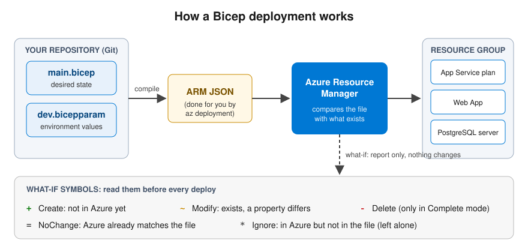
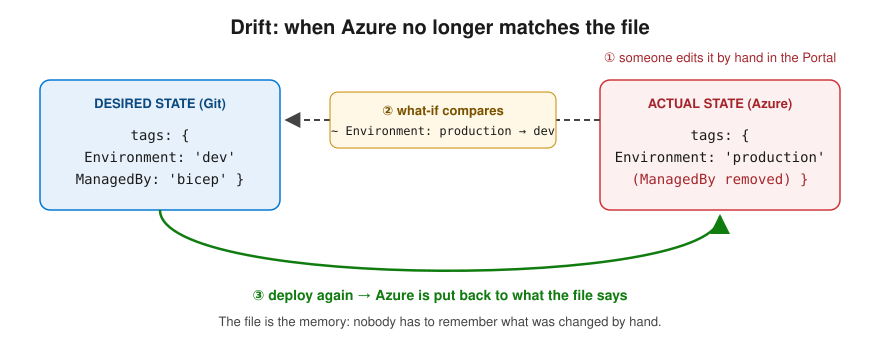

# Infrastructure as Code (IaC)
> 🇫🇮 Finnish version: [Infrastructure-as-Code.md](../../Azure/Infrastructure-as-Code.md)

## Table of Contents

1. [What is Infrastructure as Code?](#what-is-infrastructure-as-code)
2. [Why IaC?](#why-iac)
3. [IaC approaches](#iac-approaches)
4. [IaC tools in Azure](#iac-tools-in-azure)
5. [What is Bicep?](#what-is-bicep)
6. [Bicep vs. ARM template](#bicep-vs-arm-template)
7. [Bicep basics](#bicep-basics)
8. [Practical examples with Bicep](#practical-examples-with-bicep)
9. [Parameters and variables](#parameters-and-variables)
10. [Modules](#modules)
11. [IaC best practices](#iac-best-practices)
12. [Deployment](#deployment)

---

## What is Infrastructure as Code?

**Infrastructure as Code (IaC)** means managing and provisioning infrastructure (servers, networks, databases, etc.) through code files instead of manual processes.

Traditionally, infrastructure was created by hand through a portal or by running commands one at a time. With IaC, the whole environment is described as code that can be **versioned**, **repeated** and **automated**.

```
TRADITIONAL WAY (❌):
┌─────────────┐     Click in the portal      ┌──────────────┐
│  Developer  │ ──────────────────────────→  │ Azure Portal │
└─────────────┘   Manual, error-prone        └──────────────┘
                  Not repeatable
                  Not in version control

IaC WAY (✅):
┌─────────────┐     main.bicep      ┌─────────────┐     Deploy      ┌───────────┐
│  Developer  │ ─────────────────→ │     Git     │ ─────────────→ │   Azure   │
└─────────────┘  Code = Truth       └─────────────┘  Automated      └───────────┘
                 Versioned                            Repeatable
                 Reviewable                           Reliable
```

---

## Why IaC?

### Problems without IaC

| Problem | Description |
|---|---|
| **Configuration drift** | Environments differ from each other because changes have been made by hand |
| **Lack of documentation** | Nobody knows exactly what the infrastructure contains |
| **No repeatability** | Creating a new environment is laborious and error-prone |
| **No audit trail** | Nobody knows who changed what and when |
| **Slowness** | Manual provisioning takes hours |

### Benefits of IaC

| Benefit | Description |
|---|---|
| **Repeatability** | The same code always produces the same environment |
| **Version control** | The change history of the infrastructure is in Git |
| **Automation** | A CI/CD pipeline handles the deployment |
| **Self-documenting** | The code is the documentation |
| **Speed** | An environment is up in minutes |
| **Cost control** | The code shows which resources are in use |
| **Review** | Infrastructure changes go into a pull request like any other code change |

---

## IaC approaches

### Declarative vs. imperative

IaC tools follow one of two basic approaches:

```
DECLARATIVE ("What I want"):
─────────────────────────────────
"I want a web application with an App Service Plan (S1)
 and a Storage Account (LRS)"

→ The tool works out by itself what needs to be done

IMPERATIVE ("How I do it"):
──────────────────────────────
1. Create a Resource Group
2. Create an App Service Plan
3. Set the SKU to S1
4. Create a Web App
5. Create a Storage Account
6. Set replication to LRS

→ You specify every step
```

| Feature | Declarative | Imperative |
|---|---|---|
| **Describes** | The desired end state | The steps to reach the goal |
| **Idempotency** | Built in | You must implement it yourself |
| **Example tools** | Bicep, Terraform, ARM | Azure CLI scripts, Pulumi |
| **Learning curve** | Lower | Higher |
| **Flexibility** | More limited | Completely free |

> **Recommendation:** The declarative approach (such as Bicep) is recommended in most situations. It is simpler, safer and easier to maintain.

### Idempotency

**Idempotency** is a key IaC concept: running the same code several times always produces the same end result.

```
1st run: Create Storage Account → ✅ Created
2nd run: Storage Account already exists → ✅ No changes
3rd run: Storage Account already exists → ✅ No changes

→ Safe to run again at any time!
```

---

## IaC tools in Azure

| Tool | Type | Description | Recommendation |
|---|---|---|---|
| **Bicep** | Declarative | Azure's own DSL, compiles to an ARM template | ✅ Azure-native choice |
| **ARM Templates** | Declarative | JSON-based, Azure's original IaC | ⚠️ Outdated, use Bicep |
| **Terraform** | Declarative | HashiCorp's multi-cloud tool (HCL language) | ✅ Multi-cloud environments |
| **Pulumi** | Imperative | IaC with real programming languages (C#, TS, Python) | ✅ Developer-friendly |
| **Azure CLI** | Imperative | Command-line tool, scriptable | ⚠️ For ad hoc tasks |

> **Recommendation:** If you use only Azure, **Bicep** is the best choice. If you use several cloud providers, consider **Terraform**.

---

## What is Bicep?

**Bicep** is Azure's own **domain-specific language (DSL)** for describing infrastructure. It is the successor to ARM templates and offers a clearer and shorter syntax.

### Features of Bicep

- **Native Azure support** - supports all Azure resource types as soon as they are released
- **Type safety** - IntelliSense and validation with the VS Code extension
- **Modules** - Code reuse with modules
- **No state file** - Unlike Terraform, Bicep compares directly against the Azure environment
- **Free and open source** - Maintained by Microsoft

### How does Bicep work?



Bicep is a **transpiled language**: you write Bicep, which is compiled into an ARM JSON template. Azure Resource Manager always receives ARM JSON.

---

## Bicep vs. ARM template

### Comparison: Storage Account

**ARM Template (JSON) - 22 lines:**

```json
{
  "$schema": "https://schema.management.azure.com/schemas/2019-04-01/deploymentTemplate.json#",
  "contentVersion": "1.0.0.0",
  "parameters": {
    "location": {
      "type": "string",
      "defaultValue": "[resourceGroup().location]"
    }
  },
  "resources": [
    {
      "type": "Microsoft.Storage/storageAccounts",
      "apiVersion": "2023-01-01",
      "name": "myappstorage",
      "location": "[parameters('location')]",
      "sku": { "name": "Standard_LRS" },
      "kind": "StorageV2"
    }
  ]
}
```

**Bicep - 7 lines:**

```bicep
param location string = resourceGroup().location

resource storageAccount 'Microsoft.Storage/storageAccounts@2023-01-01' = {
  name: 'myappstorage'
  location: location
  sku: { name: 'Standard_LRS' }
  kind: 'StorageV2'
}
```

| Feature | ARM Template | Bicep |
|---|---|---|
| **Syntax** | JSON (verbose) | Clean DSL |
| **Line count** | ~3x more | ~3x fewer |
| **IntelliSense** | Limited | Excellent |
| **Modules** | Linked templates (complex) | Native modules |
| **Learning curve** | High | Low |
| **Support** | All Azure resources | All Azure resources |

---

## Bicep basics

### Resource definition

The basic unit of Bicep is a **resource** (`resource`):

```bicep
resource <symbolic-name> '<resource-type>@<api-version>' = {
  name: '<resource-name-in-azure>'
  location: '<location>'
  properties: {
    // Resource-specific settings
  }
}
```

### Parameters (`param`)

Parameters make a template reusable:

```bicep
// Required parameter
param appName string

// Parameter with a default value
param location string = resourceGroup().location

// Parameter with restrictions
@allowed(['dev', 'staging', 'prod'])
param environment string

// Parameter with a description
@description('Storage account SKU')
param storageSku string = 'Standard_LRS'

// Secure parameter (not shown in logs)
@secure()
param adminPassword string
```

### Variables (`var`)

Variables help you avoid repetition:

```bicep
param appName string
param environment string

// Variables are computed from parameters
var resourceGroupName = 'rg-${appName}-${environment}'
var storageAccountName = 'st${appName}${environment}'
var tags = {
  Application: appName
  Environment: environment
  ManagedBy: 'Bicep'
}
```

### Outputs (`output`)

Outputs pass information out of the deployment:

```bicep
output storageAccountId string = storageAccount.id
output storageAccountName string = storageAccount.name
output primaryEndpoint string = storageAccount.properties.primaryEndpoints.blob
```

### Conditional resource creation

```bicep
param deployRedis bool = false

resource redis 'Microsoft.Cache/redis@2023-08-01' = if (deployRedis) {
  name: 'myapp-redis'
  location: location
  properties: {
    sku: {
      name: 'Basic'
      family: 'C'
      capacity: 0
    }
  }
}
```

### Loops

```bicep
param storageNames array = ['docs', 'images', 'backups']

resource storageAccounts 'Microsoft.Storage/storageAccounts@2023-01-01' = [
  for name in storageNames: {
    name: 'st${name}${uniqueString(resourceGroup().id)}'
    location: resourceGroup().location
    sku: { name: 'Standard_LRS' }
    kind: 'StorageV2'
  }
]
```

---

## Practical examples with Bicep

### Example 1: Resource Group + Storage Account

```bicep
// File: main.bicep
// Description: Creates a Resource Group and a Storage Account
targetScope = 'subscription'

param location string = 'northeurope'
param environment string = 'dev'

// Resource Group
resource rg 'Microsoft.Resources/resourceGroups@2023-07-01' = {
  name: 'rg-myapp-${environment}'
  location: location
  tags: {
    Environment: environment
    ManagedBy: 'Bicep'
  }
}

// Storage Account (as a module inside the Resource Group)
module storage 'modules/storage.bicep' = {
  name: 'storageDeployment'
  scope: rg
  params: {
    location: location
    environment: environment
  }
}

output storageAccountName string = storage.outputs.storageAccountName
```

### Example 2: Key Vault + secrets

```bicep
// File: keyvault.bicep
// Description: Creates a Key Vault with RBAC support and an example secret

param location string = resourceGroup().location
param environment string = 'dev'
param keyVaultName string = 'kv-myapp-${environment}'

@description('Object ID of the admin user in Microsoft Entra ID')
param adminObjectId string

resource keyVault 'Microsoft.KeyVault/vaults@2023-07-01' = {
  name: keyVaultName
  location: location
  properties: {
    tenantId: subscription().tenantId
    sku: {
      family: 'A'
      name: 'standard'
    }
    enableRbacAuthorization: true    // Use RBAC instead of Access Policies
    enableSoftDelete: true
    softDeleteRetentionInDays: 90
    enablePurgeProtection: true      // Prevent permanent deletion
    networkAcls: {
      defaultAction: 'Deny'
      bypass: 'AzureServices'        // Allow access for Azure services
    }
  }
  tags: {
    Environment: environment
    ManagedBy: 'Bicep'
  }
}

// Give the admin user the Key Vault Administrator role
resource adminRoleAssignment 'Microsoft.Authorization/roleAssignments@2022-04-01' = {
  name: guid(keyVault.id, adminObjectId, 'Key Vault Administrator')
  scope: keyVault
  properties: {
    roleDefinitionId: subscriptionResourceId(
      'Microsoft.Authorization/roleDefinitions',
      '00482a5a-887f-4fb3-b363-3b7fe8e74483' // Key Vault Administrator
    )
    principalId: adminObjectId
    principalType: 'User'
  }
}

output keyVaultName string = keyVault.name
output keyVaultUri string = keyVault.properties.vaultUri
```

### Example 3: App Service + App Service Plan

```bicep
// File: appservice.bicep
// Description: Creates an App Service Plan and a Web App for a .NET application

param location string = resourceGroup().location
param appName string
param environment string = 'dev'

@allowed(['F1', 'B1', 'S1', 'P1v3'])
@description('App Service plan pricing tier')
param skuName string = 'F1'

// App Service Plan
resource appServicePlan 'Microsoft.Web/serverfarms@2023-12-01' = {
  name: 'asp-${appName}-${environment}'
  location: location
  sku: {
    name: skuName
  }
  kind: 'linux'
  properties: {
    reserved: true    // Linux
  }
  tags: {
    Environment: environment
    ManagedBy: 'Bicep'
  }
}

// Web App
resource webApp 'Microsoft.Web/sites@2023-12-01' = {
  name: 'app-${appName}-${environment}'
  location: location
  identity: {
    type: 'SystemAssigned'  // Managed Identity for Key Vault access
  }
  properties: {
    serverFarmId: appServicePlan.id
    httpsOnly: true
    siteConfig: {
      linuxFxVersion: 'DOTNETCORE|8.0'
      alwaysOn: skuName != 'F1'      // AlwaysOn is not supported on the free tier
      minTlsVersion: '1.2'
      ftpsState: 'Disabled'
      appSettings: [
        {
          name: 'ASPNETCORE_ENVIRONMENT'
          value: environment == 'prod' ? 'Production' : 'Development'
        }
      ]
    }
  }
  tags: {
    Environment: environment
    ManagedBy: 'Bicep'
  }
}

// Diagnostic logs
resource webAppDiagnostics 'Microsoft.Web/sites/config@2023-12-01' = {
  parent: webApp
  name: 'logs'
  properties: {
    applicationLogs: {
      fileSystem: {
        level: 'Information'
      }
    }
    httpLogs: {
      fileSystem: {
        retentionInMb: 35
        retentionInDays: 3
        enabled: true
      }
    }
  }
}

output webAppName string = webApp.name
output webAppUrl string = 'https://${webApp.properties.defaultHostName}'
output managedIdentityId string = webApp.identity.principalId
```

### Example 4: Complete environment (main template)

```bicep
// File: main.bicep
// Description: Complete application environment: App Service + Key Vault + Storage + SQL
targetScope = 'subscription'

@description('Application name')
param appName string

@allowed(['dev', 'staging', 'prod'])
param environment string = 'dev'

param location string = 'northeurope'

@secure()
@description('SQL database administrator password')
param sqlAdminPassword string

// Resource Group
resource rg 'Microsoft.Resources/resourceGroups@2023-07-01' = {
  name: 'rg-${appName}-${environment}'
  location: location
}

// Key Vault
module keyVault 'modules/keyvault.bicep' = {
  name: 'keyVaultDeployment'
  scope: rg
  params: {
    location: location
    environment: environment
    keyVaultName: 'kv-${appName}-${environment}'
    adminObjectId: '' // Fill in your own Object ID
  }
}

// Storage Account
module storage 'modules/storage.bicep' = {
  name: 'storageDeployment'
  scope: rg
  params: {
    location: location
    environment: environment
    storageAccountName: 'st${appName}${environment}'
  }
}

// App Service
module appService 'modules/appservice.bicep' = {
  name: 'appServiceDeployment'
  scope: rg
  params: {
    location: location
    appName: appName
    environment: environment
    skuName: environment == 'prod' ? 'S1' : 'F1'
  }
}

// Give the App Service's Managed Identity read access to Key Vault
module kvAccess 'modules/kv-role-assignment.bicep' = {
  name: 'kvAccessDeployment'
  scope: rg
  params: {
    keyVaultName: keyVault.outputs.keyVaultName
    principalId: appService.outputs.managedIdentityId
    roleName: 'Key Vault Secrets User'
  }
}

// Outputs
output resourceGroupName string = rg.name
output webAppUrl string = appService.outputs.webAppUrl
output keyVaultName string = keyVault.outputs.keyVaultName
```

### Example 5: SQL database

```bicep
// File: sql.bicep
// Description: Azure SQL Server + Database

param location string = resourceGroup().location
param appName string
param environment string = 'dev'

@secure()
param adminLogin string

@secure()
param adminPassword string

@allowed(['Basic', 'S0', 'S1', 'P1'])
param skuName string = 'Basic'

// SQL Server
resource sqlServer 'Microsoft.Sql/servers@2023-08-01-preview' = {
  name: 'sql-${appName}-${environment}'
  location: location
  properties: {
    administratorLogin: adminLogin
    administratorLoginPassword: adminPassword
    minimalTlsVersion: '1.2'
    publicNetworkAccess: environment == 'prod' ? 'Disabled' : 'Enabled'
  }
  tags: {
    Environment: environment
    ManagedBy: 'Bicep'
  }
}

// SQL Database
resource sqlDatabase 'Microsoft.Sql/servers/databases@2023-08-01-preview' = {
  parent: sqlServer
  name: 'db-${appName}-${environment}'
  location: location
  sku: {
    name: skuName
  }
  properties: {
    collation: 'SQL_Latin1_General_CP1_CI_AS'
    maxSizeBytes: 2147483648 // 2 GB
    zoneRedundant: environment == 'prod'
  }
  tags: {
    Environment: environment
    ManagedBy: 'Bicep'
  }
}

// Firewall: Allow access for Azure services
resource firewallRule 'Microsoft.Sql/servers/firewallRules@2023-08-01-preview' = {
  parent: sqlServer
  name: 'AllowAzureServices'
  properties: {
    startIpAddress: '0.0.0.0'
    endIpAddress: '0.0.0.0'
  }
}

output sqlServerFqdn string = sqlServer.properties.fullyQualifiedDomainName
output databaseName string = sqlDatabase.name
```

### Example 6: PostgreSQL Flexible Server

```bicep
// File: modules/postgres.bicep
// Description: Azure Database for PostgreSQL - Flexible Server + database + firewall

param location string = resourceGroup().location
param serverName string
param databaseName string
param environment string = 'dev'

param administratorLogin string

@secure()
param administratorLoginPassword string

// Flexible Server (Burstable B1ms — for study/development use)
resource postgresServer 'Microsoft.DBforPostgreSQL/flexibleServers@2024-08-01' = {
  name: serverName
  location: location
  sku: {
    name: 'Standard_B1ms'
    tier: 'Burstable'
  }
  properties: {
    version: '16'
    administratorLogin: administratorLogin
    administratorLoginPassword: administratorLoginPassword
    authConfig: {
      passwordAuth: 'Enabled'
      activeDirectoryAuth: 'Disabled'
    }
    network: {
      publicNetworkAccess: 'Enabled' // App Service + firewall rule; without this, what-if predicts that public access will be removed
    }
    storage: {
      storageSizeGB: 32
    }
    backup: {
      backupRetentionDays: 7
      geoRedundantBackup: 'Disabled'
    }
    highAvailability: {
      mode: 'Disabled'    // HA would double the price — not for student projects
    }
  }
  tags: {
    Environment: environment
    ManagedBy: 'Bicep'
  }
}

// The application's database
resource database 'Microsoft.DBforPostgreSQL/flexibleServers/databases@2024-08-01' = {
  parent: postgresServer
  name: databaseName
  properties: {
    charset: 'UTF8'
    collation: 'en_US.utf8'
  }
}

// Firewall: allow Azure services (0.0.0.0 is a special value, not "the whole internet")
resource allowAzureServices 'Microsoft.DBforPostgreSQL/flexibleServers/firewallRules@2024-08-01' = {
  parent: postgresServer
  name: 'AllowAzureServices'
  properties: {
    startIpAddress: '0.0.0.0'
    endIpAddress: '0.0.0.0'
  }
}

output serverFqdn string = postgresServer.properties.fullyQualifiedDomainName
output databaseName string = database.name
```

> More about the service: [Azure Database for PostgreSQL](Azure-Database-PostgreSQL.md)

---

## Parameters and variables

### Parameter file (`bicepparam`)

Parameters can be separated into their own file per environment:

```bicep
// File: main.bicepparam (dev environment)
using 'main.bicep'

param appName = 'myapp'
param environment = 'dev'
param location = 'northeurope'
param sqlAdminPassword = readEnvironmentVariable('SQL_ADMIN_PASSWORD')
```

```bicep
// File: main.prod.bicepparam (production environment)
using 'main.bicep'

param appName = 'myapp'
param environment = 'prod'
param location = 'northeurope'
param sqlAdminPassword = readEnvironmentVariable('SQL_ADMIN_PASSWORD')
```

### Naming strategy

A good naming convention makes resources easier to identify:

```bicep
// Naming variables
var naming = {
  resourceGroup: 'rg-${appName}-${environment}'
  appServicePlan: 'asp-${appName}-${environment}'
  webApp: 'app-${appName}-${environment}'
  keyVault: 'kv-${appName}-${environment}'
  storage: 'st${appName}${environment}'    // No hyphens (Azure restriction)
  sqlServer: 'sql-${appName}-${environment}'
  sqlDatabase: 'db-${appName}-${environment}'
}
```

| Resource | Format | Example |
|---|---|---|
| Resource Group | `rg-<app>-<env>` | `rg-myapp-dev` |
| App Service Plan | `asp-<app>-<env>` | `asp-myapp-dev` |
| Web App | `app-<app>-<env>` | `app-myapp-dev` |
| Key Vault | `kv-<app>-<env>` | `kv-myapp-dev` |
| Storage Account | `st<app><env>` | `stmyappdev` |
| SQL Server | `sql-<app>-<env>` | `sql-myapp-dev` |

> The naming is based on [Azure's official recommendations](https://learn.microsoft.com/en-us/azure/cloud-adoption-framework/ready/azure-best-practices/resource-naming).

---

## Modules

### Module structure

Modules make it possible to reuse and organise Bicep code:

```
infra/
├── main.bicep              # Main template
├── main.bicepparam         # Dev parameters
├── main.prod.bicepparam    # Prod parameters
└── modules/
    ├── appservice.bicep    # App Service module
    ├── keyvault.bicep      # Key Vault module
    ├── storage.bicep       # Storage module
    ├── sql.bicep           # SQL module
    └── kv-role-assignment.bicep  # Role assignment module
```

### Calling a module

```bicep
// In the main template (main.bicep)
module storage 'modules/storage.bicep' = {
  name: 'storageDeployment'          // Name of the deployment
  scope: rg                          // Target resource group
  params: {                          // Parameters for the module
    location: location
    environment: environment
    storageAccountName: naming.storage
  }
}

// Using the module's output
output storageName string = storage.outputs.storageAccountName
```

### Example module: Storage Account

```bicep
// File: modules/storage.bicep

param location string
param environment string
param storageAccountName string

@allowed(['Standard_LRS', 'Standard_GRS', 'Standard_ZRS'])
param skuName string = environment == 'prod' ? 'Standard_ZRS' : 'Standard_LRS'

resource storageAccount 'Microsoft.Storage/storageAccounts@2023-01-01' = {
  name: storageAccountName
  location: location
  sku: { name: skuName }
  kind: 'StorageV2'
  properties: {
    minimumTlsVersion: 'TLS1_2'
    allowBlobPublicAccess: false
    supportsHttpsTrafficOnly: true
    accessTier: 'Hot'
  }
  tags: {
    Environment: environment
    ManagedBy: 'Bicep'
  }
}

output storageAccountName string = storageAccount.name
output storageAccountId string = storageAccount.id
output primaryBlobEndpoint string = storageAccount.properties.primaryEndpoints.blob
```

---

## IaC best practices

### ✅ Good practices

- **Version control** - Keep all IaC code in Git
- **Environment-specific parameters** - Use separate parameter files (dev, staging, prod)
- **Modules** - Split the code into reusable modules
- **Naming conventions** - Follow consistent naming (see above)
- **Tags** - Add tags to resources (Environment, ManagedBy, Owner)
- **Check before deploying** - Use the `what-if` command to preview changes
- **CI/CD** - Automate deployment (GitHub Actions, Azure DevOps)
- **Don't modify resources by hand** - All changes go through IaC

### ❌ Avoid these

- Don't hard-code values - use parameters and variables
- Don't skip the `what-if` check in production
- Don't store secrets in IaC code - use Key Vault or environment variables
- Don't create resources without tags
- Don't make large changes all at once - smaller changes are safer

---

## Deployment

### Azure CLI

```bash
# 1. Sign in
az login

# 2. Select the subscription
az account set --subscription "My Subscription"

# 3. Check the changes (what-if) - ALWAYS FIRST!
az deployment sub what-if \
  --location northeurope \
  --template-file main.bicep \
  --parameters main.bicepparam

# 4. Run the deployment
az deployment sub create \
  --location northeurope \
  --template-file main.bicep \
  --parameters main.bicepparam \
  --name "deploy-$(date +%Y%m%d-%H%M%S)"
```

### Resource Group level deployment

```bash
# If targetScope is 'resourceGroup' (the default)
az deployment group create \
  --resource-group rg-myapp-dev \
  --template-file appservice.bicep \
  --parameters appName='myapp' environment='dev'
```

### What-if check

`what-if` shows what changes the deployment would make **without actually changing anything**:

```bash
az deployment group what-if \
  --resource-group rg-myapp-dev \
  --template-file main.bicep \
  --parameters main.bicepparam
```

```
Output:
  + Microsoft.Storage/storageAccounts  stmyappdev        [Create]
  ~ Microsoft.Web/sites               app-myapp-dev      [Modify]
    - Microsoft.Cache/redis            myapp-redis        [Delete]
```

> **Incremental vs. Complete mode:** `az deployment group create` uses **Incremental** mode by default. Resources that exist in Azure but are missing from the file are **left alone** (what-if marks them with `*` Ignore). A `-` Delete appears only with `--mode Complete`, which removes everything the file does not describe. Use Complete mode only when you are sure the file describes the *whole* resource group.

### Drift: when someone changes Azure by hand

**Drift** means the actual environment no longer matches the code, for example because someone changed a setting in the Portal. Because Bicep has no state file, what-if compares the file directly with Azure and shows the drift as a `~` line. Deploying again puts Azure back to the state the file describes.



> **Rule of thumb:** If a change is worth keeping, make it in the Bicep file and deploy it. A change made only in the Portal will be overwritten by the next deployment.

### GitHub Actions example

```yaml
# .github/workflows/deploy-infra.yml
name: Deploy Infrastructure

on:
  push:
    branches: [main]
    paths: ['infra/**']

permissions:
  id-token: write    # OIDC authentication
  contents: read

jobs:
  deploy:
    runs-on: ubuntu-latest
    steps:
      - uses: actions/checkout@v4

      - uses: azure/login@v2
        with:
          client-id: ${{ secrets.AZURE_CLIENT_ID }}
          tenant-id: ${{ secrets.AZURE_TENANT_ID }}
          subscription-id: ${{ secrets.AZURE_SUBSCRIPTION_ID }}

      - name: What-If
        uses: azure/arm-deploy@v2
        with:
          scope: subscription
          region: northeurope
          template: infra/main.bicep
          parameters: infra/main.bicepparam
          additionalArguments: --what-if

      - name: Deploy
        uses: azure/arm-deploy@v2
        with:
          scope: subscription
          region: northeurope
          template: infra/main.bicep
          parameters: infra/main.bicepparam
          deploymentName: deploy-${{ github.run_number }}
```

---

## Summary

| Concept | Description |
|---|---|
| **IaC** | Managing infrastructure as code |
| **Declarative** | Describes the desired end state (Bicep, Terraform) |
| **Imperative** | Describes the steps to reach the goal (CLI scripts, Pulumi) |
| **Idempotency** | Same code = same result, always |
| **Bicep** | Azure's own IaC language, successor to ARM templates |
| **Modules** | Code reuse and organisation |
| **What-if** | Previewing changes before deployment |
| **Parameter file** | Environment-specific settings in a separate file |

---

## Back

- [Azure services](README.md)

## Useful links

- [Bicep Documentation](https://learn.microsoft.com/en-us/azure/azure-resource-manager/bicep/)
- [Bicep Playground](https://aka.ms/bicepdemo) - Try Bicep in the browser
- [Azure Verified Modules](https://aka.ms/avm) - Ready-made, tested Bicep modules
- [Bicep VS Code Extension](https://marketplace.visualstudio.com/items?itemName=ms-azuretools.vscode-bicep)
- [Azure Naming Conventions](https://learn.microsoft.com/en-us/azure/cloud-adoption-framework/ready/azure-best-practices/resource-naming)
- [ARM Template Reference](https://learn.microsoft.com/en-us/azure/templates/)
